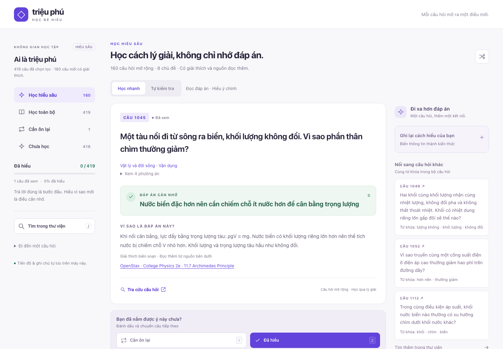

# Triệu phú · Học để hiểu

An offline study app for Vietnamese learners, built on quiz-show-style multiple-choice questions. It goes beyond checking your answer: it explains *why* an answer is right, links to further reading, and tracks which questions you actually understand.



- **419 questions:** 160 original reasoning questions across eight subjects, plus 259 curated questions from the book *Bộ câu hỏi Ai là triệu phú 2018*.
- **Every question has an explanation**, and every original question links to a reputable reading source.
- **Runs entirely in the browser.** No install, account, build step or tracking, and it works offline.

The interface is in Vietnamese.

## Quick start

Clone or download the repository and open `index.html` in a browser. Keep `index.html` and the `data/` folder together.

To serve it locally instead (requires Node.js 22+):

```sh
npm start
```

Then open <http://localhost:4173>. The server listens on `127.0.0.1` only and serves only the app's files. Set `PORT` to use a different port.

## Features

### Two study modes

- **Học nhanh** (quick study) shows the answer and explanation immediately. The four choices stay collapsed, so you can focus on the key idea.
- **Tự kiểm tra** (self-test) hides the answer, explanation, notes and related questions until you choose A–D or reveal the answer.

Once the answer is shown, rate yourself **Cần ôn lại** (review again) or **Đã hiểu** (understood) to move on. A correct choice alone doesn't count as understanding. A wrong choice adds the question to review.

### Study rounds

| Round | Contents |
| --- | --- |
| **Học hiểu sâu** | The 160 original questions |
| **Học toàn bộ** | The whole bank |
| **Chưa học** | Questions you haven't seen yet |
| **Cần ôn lại** | Questions you've seen but haven't marked as understood |

The question list is fixed when a round starts, so rating a question never skips the next one.

### Going further

- **Personal notes** (**Ghi lại cách hiểu của bạn**): explain the answer in your own words and write down a follow-up question. Notes save as you type.
- **Related questions** (**Nối sang câu hỏi khác**): up to three questions that share key words or phrases with the current one. These suggestions come from word overlap, not from verified links between concepts.
- **Library** (**Tìm trong thư viện**): search question text, choices, topics and question numbers, with or without Vietnamese diacritics. Filter by unseen, review, understood, or questions with notes. Search results never reveal answers.
- **Google lookup** (**Tra cứu câu hỏi**): searches for the question text only, without the choices, answer or your notes.

### Keyboard shortcuts

These work whenever the cursor isn't in a text field.

| Key | Action |
| --- | --- |
| <kbd>←</kbd> / <kbd>→</kbd> | Previous / next question |
| <kbd>A</kbd>–<kbd>D</kbd> | Answer (self-test mode) |
| <kbd>Space</kbd> | Reveal the answer |
| <kbd>1</kbd> / <kbd>2</kbd> | Mark for review / understood, then advance |
| <kbd>/</kbd> | Open the library (<kbd>Esc</kbd> closes it) |

## Question bank

### Original questions (IDs 1045–1204)

There are 160 questions, 20 in each of eight subjects: physics, chemistry and materials, biology and ecology, Earth and astronomy, probability and data, mathematics and reasoning, computing and technology, and economics and decision-making.

Each question has:

- four distinct choices;
- a difficulty label, either **Vận dụng** (applied) or **Khó** (hard);
- an explanation of the mechanism or calculation;
- at least one reading link, from sources such as OpenStax, NASA, NOAA, USGS, MIT OpenCourseWare, Harvard CS50, MDN, the PostgreSQL docs and Google's Machine Learning Crash Course.

The questions and their wording were written for this project. The links are for further reading and weren't the source of the questions. The set deliberately avoids year-specific news, awards, sports results, rankings that change and name-recognition trivia. Difficulty labels are an editorial judgment, not calibrated scores.

### Book questions

The 259 book questions come from *Bộ câu hỏi Ai là triệu phú 2018* (VTV, second edition, 2020). They keep their original wording, answer keys, explanations and printed page numbers, which the app shows as **Trang N**. They have not been fact-checked or updated since publication.

Of the book's 1,044 questions:

- 606 were removed as too easy.
- 179 more were set aside for editorial reasons: dated results, celebrity trivia, claims that go out of date, duplicates and ambiguous answers. The reasons are recorded in `data/editorial-exclusions.json`.
- 46 of the remaining 259 have no explanation in the book. They get one written for this project, which the app labels as not from the book.

Original question numbers are kept, so the numbering has gaps.

## Privacy

Your progress, notes and current position are saved in your browser's `localStorage` and never leave your device. The app has no analytics or accounts and loads no third-party assets. Only two things go online: the Google lookup, which sends the question text and nothing else, and the reading links you choose to open.

Progress is stored separately for each browser and each address, so opening `index.html` directly and opening `localhost:4173` give you two separate sets of progress. Clearing your browser's site data erases it.

## Development

There are no dependencies. You only need Node.js 22+ for the local server, the data build and the tests.

```sh
npm test            # data integrity, search, review queues and progress handling
npm run build:data  # regenerate data/questions.js after editing data/*.json
npm run check:data  # fail if data/questions.js is out of date (runs in CI)
```

### Project structure

```text
index.html, styles.css, app.js     Interface and interactions
study-core.js                      Search, review queues, progress validation, related questions
server.mjs                         Optional local static server
data/
  learning-questions.json          Source: the 160 original questions
  book-questions.json              Source: the 438 book questions left after the difficulty cut
  book-explanations.json           Source: explanations for book questions the book doesn't explain
  editorial-exclusions.json        Book questions set aside, grouped by reason
  excluded-easy-question-ids.json  Book question IDs removed as too easy
  questions.js                     Generated question bank loaded by the app (do not edit)
scripts/build_questions.mjs        Validates the sources and generates data/questions.js
tests/study.test.cjs               Test suite
```

`data/questions.js` is a plain script rather than JSON, so the app still works when `index.html` is opened directly from disk. Commit it whenever you rebuild.

### Adding or editing questions

1. Edit the source files in `data/`. A new original question goes in `learning-questions.json`:

   ```json
   {
     "id": 1205,
     "kind": "learning",
     "topic": "Vật lý và đời sống",
     "difficulty": "medium",
     "question": "…",
     "options": { "A": "…", "B": "…", "C": "…", "D": "…" },
     "explanation": "…",
     "references": [{ "title": "…", "url": "https://…" }],
     "answer": "B"
   }
   ```

   - `id` must be unique and greater than 1044, because 1–1044 are the book's numbers.
   - `difficulty` is `medium` (Vận dụng) or `hard` (Khó).
   - `explanation` must be at least 120 characters, and every reference URL must use HTTPS.

2. Run `npm run build:data`. The build fails on duplicate IDs or question text, an invalid answer key, duplicate choices, or a missing explanation or reference.

3. Run `npm test`. The tests lock in properties of the current bank: question counts, 20 questions per subject, an even spread of correct answers across A–D, and an allowlist of reference domains. When you change the bank on purpose, update the tests to match.

To set aside a book question, add its ID to a group in `data/editorial-exclusions.json` and rebuild.

## License

- **Code:** [MIT](LICENSE).
- **Original questions, explanations and editorial data:** [CC BY 4.0](CONTENT-LICENSE.md).
- **Book questions** (`data/book-questions.json` and the copies of them in `data/questions.js`): owned by their copyright holders and **not** covered by either license. See [CONTENT-LICENSE.md](CONTENT-LICENSE.md).

This is an independent study project. It is not affiliated with or endorsed by VTV or the owners of the *Ai là triệu phú* / *Who Wants to Be a Millionaire?* format.
